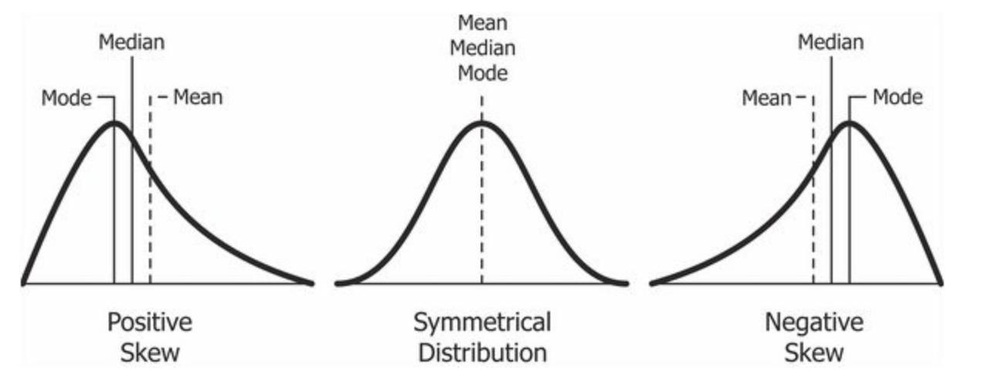
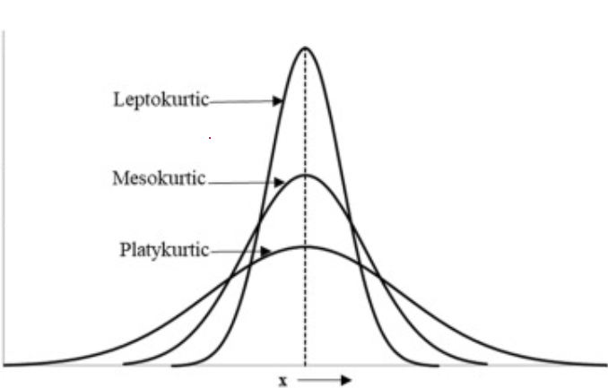

# Skewness and Kurtosis

**Measures of shape** are tools that can be used to describe the shape of a distribution of data. In this section, we examine two measures of shape, **skewness** and **kurtosis**.

## Skewness

Skewness refers to lack of symmetry or departure from symmetry. There are three types of skewness based on the histogram or density plot of data.

a\) **Positive skewness**/ Skewed right- where *mean\>median\>mode*

b\) **Symmetrical distribution**- in a perfect symmetrical distribution *mean=median=mode*

c\) **Negative skewness**/ Skewed left- where *mean\<median\<mode*

The typical example of skewness is exhibited in @fig-skewness with the relative position of mean, median and mode.

{#fig-skewness fig-align="center" width="516"}

```{r}
set.seed(1)

skewR<-5+rbeta(10000,2,8)*20
mean.sk=mean(skewR)
median.sk=median(skewR)

#hist(skewR,freq = F,col = "white")
#lines(density(skewR),lwd=2)
#abline(v=mean.sk,col="red",lwd=2)
#abline(v=median.sk,col="green",lwd=2)
#arrows(x0 = mean.sk, y0 = 0.15,x1 = mean.sk, y1 = 0)
```

## Kurtosis

**Kurtosis** *describes the amount of peakedness of a distribution*.

- Distributions that are high and thin are referred to as **leptokurtic** distributions.

- Distributions that are flat and spread out are referred to as **platykurtic** distributions.

- Between these two types are distributions that are more “normal” in shape, referred to as **mesokurtic** distributions.

These three types of kurtosis are illustrated in @fig-kurtosis.

{#fig-kurtosis width="416"}

## Measures of skewness and kurtosis

The coefficient of Skewness,
$$S_k=\frac{1}{n}\frac{\sum (X-\bar X)^3}{s^3}$$

Decision:

a)  $S_k>0$ implies positive skewness
b)  $S_k<0$ implies negative skewness
c)  $S_k \approx 0$ implies symmetric/ zero skewness

The coefficient of kurtosis,

$$ 
K_t=\frac{1}{n}\frac{\sum (X-\bar X)^4}{s^4}$$

Decision:

a)  $K_t > 3$ implies *leptokurtic*

b)  $K_t <3$ implies *platykurtic*

c)  $K_t \approx 3$ implies *mesokurtic*

## **Example (8/10 marks)**

a)  **Calculate** the coefficient of skeweness ($S_k$) and coefficient of kurtosis ($K_t$).

b)  **Comment** about the skewness and kurtosis of the data

**Data:** 3,5,6,9,12

[Solution:]{.underline}

```{r}

moments<-function(x,r){
  x_bar=mean(x)
  n=length(x)
  mr=numeric(r)
  for (i in 1:r) {
    mr[i]=sum((x-x_bar)^i)/n
    #print(mr[i])
  }
  return(mr)
}

x=c(3,5,6,9,12)

#moments(x,4)

#sd(x)


```

- Here sample mean, $\bar x=\frac{\sum x}{n}=\frac{3+5+...+12}{5}=7$

| $x$ | $(x-\bar x)$ | $(x-\bar x)^2$ | $(x-\bar x)^3$ | $(x-\bar x)^4$ |
|:-------------:|:-------------:|:-------------:|:-------------:|:-------------:|
| 3 | -4 | 16 | -64 | 256 |
| 5 | -2 | 4 | -8 | 16 |
| 6 | -1 | 1 | -1 | 1 |
| 9 | 2 | 4 | 8 | 16 |
| 12 | 5 | 25 | 125 | 625 |
| $\sum x=35$ | $\sum (x-\bar x)=0$ | $\sum(x-\bar x)^2=50$ | $\sum(x-\bar x)^3=60$ | $\sum (x-\bar x)^4=914$ |

- Sample standard deviation,

  $$s=\sqrt \frac{\sum(x-\bar x)^2}{n-1}=\sqrt \frac{50}{5-1}=3.54 \ \  (approx.)$$

- **Coefficient of skewness**

  $$S_k=\frac{1}{n} \frac{\sum (x-\bar x)^3}{s^3}=0.27 >0$$

So the distribution is *positively skewed*.

- **Coefficient of kurtosis**

$$K_t=\frac{1}{n} \frac{\sum (x-\bar x)^4}{s^4}=1.16<3$$

So the distribution is *platykurtic*.

## **Exercise**

A sample of 7 data entry clerks employed in the Harry County Tax Office revised the following *number of tax records* last hour: 100, 75, 70, 65, 80, 68 and 50.

**Comment** about *skewness* and *kurtosis* of the *number of tax records*.
